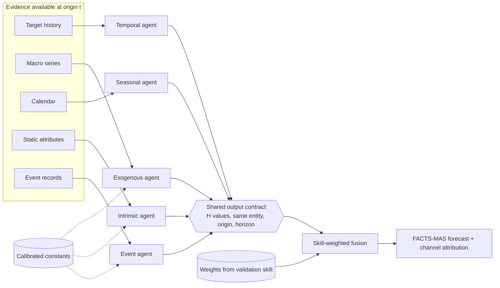

# FACTS-MAS

**Forecasting from Adaptive, Calibrated, Testable Sources: a Multi-Agent System**

Madumita Karthikeyan, Umang Rajnikant Bid, Rong Pan. Arizona State University.

📄 **Paper:** [FACTS-MAS: A Multi-Agent Architecture for Adaptive Forecasting from Heterogeneous Evidence (PDF)](paper/FACTS_MAS.pdf)

FACTS-MAS is a forecasting framework that splits the evidence behind a forecast into separate channels, such as recent dynamics, seasonality, economic conditions, structural attributes and discrete events. Each channel produces its own numerical forecast, and each one has to prove it beats a simple reference on historical data before it is allowed to influence the final forecast. Channels that do not help are down-weighted, and calibration is allowed to set an unsupported effect to zero.

The main case study forecasts weekly for-sale housing inventory for 15 U.S. metropolitan areas at 4, 8 and 13 weeks ahead. The method is also transferred to weekly unemployment insurance claims.

This branch (`audit-oct2026`) holds the final, audited version of the project:
- a frozen configuration;
- a six-fold backtest;
- a pre-registered holdout on 2026 data;
- every script and table behind the numbers in the paper.

---

## Contents

1. [Results at a glance](#1-results-at-a-glance)
2. [The idea](#2-the-idea)
3. [Architecture](#3-architecture)
4. [The housing configuration](#4-the-housing-configuration)
5. [Evaluation protocol](#5-evaluation-protocol)
6. [Detailed results](#6-detailed-results)
7. [What did not work, and why](#7-what-did-not-work-and-why)
8. [Second domain: unemployment claims](#8-second-domain-unemployment-claims)
9. [Repository layout](#9-repository-layout)
10. [Getting started](#10-getting-started)
11. [Reproducing the results](#11-reproducing-the-results)
12. [Data notes](#12-data-notes)
13. [Limitations](#13-limitations)
14. [Project history](#14-project-history)
15. [Citation and contact](#15-citation-and-contact)

---

## 1. Results at a glance

All numbers are mean absolute percentage error (MAPE, %, lower is better) over 15 metros, on Zillow's smoothed inventory series unless stated otherwise.

**Backtest:** six expanding folds, 2021-2025, every weekly forecast origin in each test window.

| Method | 4 weeks | 8 weeks | 13 weeks |
|---|---|---|---|
| Naive (last value) | 4.194 | 7.225 | 10.814 |
| TimesFM 2.5 (foundation model) | 2.361 | 4.860 | 8.269 |
| Factor-adjusted damped ETS (best single model) | **1.974** | **3.608** | **5.664** |
| **FACTS-MAS (final configuration)** | 2.118 | 3.622 | 5.731 |

**Holdout:** forecast origins from February 28 to September 12, 2026. None of this data was looked at until the configuration was frozen.

| Method | 4 weeks | 8 weeks | 13 weeks* |
|---|---|---|---|
| Naive (last value) | 3.122 | 5.445 | 8.438 |
| TimesFM 2.5 | 1.410 | 2.602 | 4.457 |
| Chain-of-thought LLM (NEXUS prompt, gpt-5.6-luna) | 1.259 | 2.225 | 3.268 |
| Factor-adjusted damped ETS | **1.138** | 1.936 | 3.080 |
| **FACTS-MAS** | 1.243 | **1.929** | **3.045** |

\*Only 20 weekly origins have a complete 13-week target, so 13-week holdout results are descriptive.

**In short:**
- **Against naive:** FACTS-MAS cuts the naive forecast's error by about half in the backtest and by about 60% on the holdout. On the unsmoothed series the reduction is smaller, 24-37% in the backtest.
- **Against TimesFM:** it is significantly more accurate at every horizon (p ≤ 0.006).
- **Against the LLM:** its error is lower than the chain-of-thought forecast, but the difference is not statistically significant.
- **Against the best single model:** it is **not** more accurate than a factor-adjusted damped exponential smoothing model. The two are statistically equivalent at 8 weeks, and the single model is slightly better at 4 weeks.

So the value of FACTS-MAS is the protocol, not an accuracy gain from fusion. The protocol tested five evidence channels, rejected the ones without predictive signal, and recombined the forecast from the ones that survived. Section 7 explains why fusion could not add more.

---

## 2. The idea

Most forecasting systems put every input into one model, whether a regression, a neural network or a single LLM prompt. That can capture interactions, but it makes it hard to tell which input actually helped. It also forces very different kinds of evidence (a time series, a calendar effect, a static attribute, a news event) into one input format.

FACTS-MAS takes the opposite approach:

- **Channels by function, not by dataset.** Evidence is grouped by the role it plays: temporal, exogenous, seasonal, structural (intrinsic) and event. The same roles exist in housing, unemployment or energy, even though the raw data differ.
- **One agent per channel, one shared output format.** Every agent returns an H-step numerical forecast under the same contract. Any model (a statistical smoother, a regression, a foundation model, an LLM-assisted interpreter) can fill a channel.
- **Every channel is a hypothesis.** Including a channel does not mean it helps. Its skill is measured against a naive reference on historical validation data, and its weight follows from that skill.
- **Nulls are allowed.** Calibration may set a constant to zero (for example an event-impact scale), and a channel with no skill gets almost no weight. A null result is reported, not tuned away.

---

## 3. Architecture

### 3.1 Forecast flow at one origin



Weights and constants are estimated **before** the test period. Weights come from validation skill, estimated once per fold from a 104-week window ending at the training cutoff. Constants come from an offline calibration step that may return zero.

### 3.2 Components

| Component | What it does | Code |
|---|---|---|
| Agent contract | Every agent returns `(agent, entity, origin, H, H forecasts, optional confidences)`; length and non-negativity are enforced | `facts_mas/schema.py` |
| Temporal agent | Exponential smoothing on the target's own history | `facts_mas/agents/ar_agent.py`, `ar_agent.py` |
| Seasonal agent | Ratio-to-moving-average seasonal factors; forecast = last value × factor ratio | `facts_mas/agents/seasonality_agent.py` |
| Exogenous agent | Ridge regression of inventory change on lagged macro series | `facts_mas/agents/macro_agent.py`, `macro_agent.py` |
| Intrinsic agent | Ridge estimate of a structural inventory level, with gradual reversion toward it | `facts_mas/agents/intrinsic_agent.py` |
| Event agent | LLM interpretation of FEMA declarations into type, magnitude and confidence, with confidence gating | `facts_mas/agents/event_agent.py`, `event_agent.py` |
| Fusion | Skill vs naive, median aggregation, softmax weights, optional horizon/regime conditioning | `facts_mas/fusion_baseline.py` |
| Calibration | Offline sweeps that choose constants on validation folds, with a fold-consistency rule | `facts_mas/calibration.py` |
| Backtest harness | Six expanding folds with a 13-week embargo | `facts_mas/run_backtest.py`, `fold_boundaries.py` |
| Attribution and ablation | Channel contributions and leave-one-out effects | `facts_mas/factor_attribution.py`, `facts_mas/ablation.py` |
| Final holdout runner | Rebuilds the frozen configuration from agent code and scores it | `audit_reports/phase7/run_holdout.py` |

### 3.3 Skill and weights

For agent *k* and the naive reference *b*, at each validation point *i*:

```
error        e_k,i = |y_i - ŷ_k,i| / |y_i|
skill        s_k,i = 1 - e_k,i / e_b,i            (> 0 beats naive, ≈ 0 matches it, < 0 worse)
aggregate    s̃_k   = median_i( s_k,i )           (median, because the ratio explodes when e_b,i is near 0)
weight       w_k   = exp(s̃_k / τ) / Σ_j exp(s̃_j / τ),   τ = 0.05
forecast     ŷ     = Σ_k w_k · ŷ_k
```

- **Why skill:** skill relative to naive means a channel that only copies the last value gets about zero skill, even when its raw error looks good.
- **Why softmax:** it keeps the full ranking, including among channels that are worse than naive.
- **How τ was set:** by hand, from the scale of validation skill. A validation-selected τ was tested and not adopted.

### 3.4 Horizon and regime conditioning

Weights can be pooled, or computed separately per horizon and per monetary-policy regime:
- **Regimes:** defined from the 13-week change in the federal funds rate (hiking above +0.25, cutting below −0.25, stable otherwise), measured at the forecast origin.
- **Choosing pooled or conditioned:** for each fold and horizon, validation picks whichever gives lower error.
- **Sufficiency rule:** a regime-specific weight vector is used only when that regime has at least **13 distinct validation weeks**. Otherwise the pooled weights apply.

### 3.5 Calibration

Each domain constant is chosen on validation data:
- the event-impact scale;
- the event-window duration;
- the intrinsic reversion cap.

A candidate is promoted only if it improves validation error in at least 5 of the 6 folds. Zero is always a candidate, and in housing it won for both the event scale and the reversion cap.

### 3.6 Attribution

Contributions are measured on the forecasted change, not the level: `C_k = w_k · (ŷ_k − y_t)`. A channel that repeats the last value therefore gets a contribution of zero. Weights describe predictive usefulness under this procedure, not causal effects.

---

## 4. The housing configuration

### 4.1 Data

| Item | Detail |
|---|---|
| Target | Zillow weekly for-sale inventory, metro level, smoothed series (a four-week trailing average). The unsmoothed series is used as a robustness check. |
| Metros | New York, Los Angeles, Chicago, Dallas, Houston, Washington DC, Miami, Philadelphia, Atlanta, Phoenix, Boston, San Francisco, Riverside, Detroit, Seattle |
| History | From 2018-02-03. Backtest data through 2026-02-21; holdout download of 2026-10-20 with data through 2026-10-10 (454 weeks × 15 metros). No value on or before 2026-02-21 was revised between downloads. |
| Macro (FRED) | 30-year mortgage rate, effective federal funds rate, CPI, unemployment rate, shifted forward by publication delays (32 / 35 / 42 days for monthly series) and attached by a backward as-of join |
| Structural | Population, median income, housing units, density (Census ACS), hazard index (NOAA Storm Events) |
| Events | FEMA disaster declarations (OpenFEMA), mapped from counties to metros |

### 4.2 Final configuration

The frozen system is defined in [`audit_reports/FINAL_CONFIG.md`](audit_reports/FINAL_CONFIG.md):

| Horizon | Channels used | Temporal model |
|---|---|---|
| 4 weeks | temporal, seasonal, exogenous | Holt's linear-trend ETS (no seasonal term) |
| 8 and 13 weeks | temporal, seasonal, exogenous | Factor-adjusted damped ETS: divide by the seasonal factors, fit a damped additive trend, multiply the factors back |

Shared settings:
- **Seasonal factors:** 7-week circular smoothing, chosen on validation in every fold.
- **Weights:** a 104-week validation window, with validation targets restricted to dates on or before the training cutoff.
- **Fusion:** τ = 0.05, the 13-week sufficiency rule, and pooled-versus-regime selection per horizon.

**Retired channels.** Both are kept in the framework and reported as tested nulls:
- **Event:** the calibrated impact scale is 0, so its forecast equals naive.
- **Intrinsic:** the calibrated reversion cap is 0, which also makes it equal naive.

The factor-adjusted damped model is a classical method: damped trend (Gardner & McKenzie, 1985) on seasonally adjusted data, as in the M-competition benchmarks. It reuses the FACTS-MAS seasonal factors, and it entered the system through a promotion rule written down before it was tested.

---

## 5. Evaluation protocol

### 5.1 Folds

Six expanding folds, with a 13-week embargo between training end and test start. Forecasts are made at **every** weekly origin in each test window, giving 2,610 / 2,565 / 2,490 metro-origin cells per horizon in the backtest.

| Fold | Train start | Train end | Test start | Test end |
|---|---|---|---|---|
| 1 | 2019-02-02 | 2021-01-23 | 2021-05-01 | 2021-11-13 |
| 2 | 2019-02-02 | 2021-11-13 | 2022-02-19 | 2022-09-03 |
| 3 | 2019-02-02 | 2022-09-03 | 2022-12-10 | 2023-06-24 |
| 4 | 2019-02-02 | 2023-06-24 | 2023-09-30 | 2024-04-13 |
| 5 | 2019-02-02 | 2024-04-13 | 2024-07-20 | 2025-02-01 |
| 6 | 2019-02-02 | 2025-02-01 | 2025-05-10 | 2025-11-22 |
| Holdout | 2019-02-02 | 2026-02-21 | 2026-02-28 | 2026-09-12 |

Test start and end are the first and last forecast origins.

### 5.2 Information rules

- A forecast at origin *t* uses only data dated on or before *t*, after publication delays.
- Validation forecasts used for weights must have targets on or before the training cutoff, so none falls inside the embargo.
- Backtest targets on or after **2026-01-01** are excluded. That period is reserved for the holdout.
- Zillow publishes each week one to two weeks late. The holdout is therefore also scored with a **two-week publication lag**.

### 5.3 The holdout

The configuration, four hypotheses and the statistical tests were written down and committed before any 2026 data was downloaded:

| | Hypothesis | Result (smoothed, no lag) |
|---|---|---|
| H1 | FACTS-MAS beats naive at every horizon | Supported: −1.88 [95% CI −3.03, −0.90], −3.52 [−5.68, −1.70], −5.39 [−7.68, −3.07] |
| H2 | FA-ETS-d beats naive at every horizon | Supported |
| H3 | FACTS-MAS ≈ FA-ETS-d at 8 and 13 weeks (90% CI within ±2%) | Supported: equivalent at 8 weeks; 13 weeks descriptive |
| H4 | FA-ETS-d ≤ FACTS-MAS at 4 weeks | Supported: +0.105 [−0.007, +0.182], p = 0.044 |

### 5.4 Statistics

- **Accuracy metrics:** MAPE per cell (averaged over steps 1..H), plus RMSE.
- **Panel test:** a Diebold-Mariano test on weekly cross-section means, with a Newey-West variance (lag H−1).
- **Per-metro tests:** Diebold-Mariano with the Harvey-Leybourne-Newbold correction and Benjamini-Hochberg control across the 15 metros.
- **Confidence intervals:** a moving block bootstrap over whole weeks (5,000 draws; block 13 in the backtest, block = horizon on the holdout).
- **Equivalence:** the 90% CI of the difference lies within ±2% of the reference MAPE.
- **Ranking all methods:** a model confidence set.
- **Macro regression:** Holm correction, wild cluster bootstrap and Driscoll-Kraay errors.

---

## 6. Detailed results

### 6.1 Backtest, both series

| Method | Smoothed 4w | 8w | 13w | Unsmoothed 4w | 8w | 13w |
|---|---|---|---|---|---|---|
| Naive | 4.194 | 7.225 | 10.814 | 4.785 | 7.882 | 11.438 |
| Seasonal naive | 20.771 | 20.513 | 20.597 | | | |
| Seasonally adjusted naive (seasonal channel) | 2.890 | 4.774 | 6.945 | 3.626 | 5.408 | 7.489 |
| Holt (temporal channel) | 2.368 | 5.430 | 10.225 | 4.317 | 7.901 | 13.022 |
| Theta (factor-adjusted) | 2.933 | 4.842 | 7.047 | | | |
| FA-ETS-d | **1.974** | **3.608** | **5.664** | **3.402** | **5.105** | **7.164** |
| FACTS-MAS | 2.118 | 3.622 | 5.731 | 3.642 | 5.159 | 7.189 |

**FACTS-MAS against naive:**
- Panel DM t = −6.9 / −6.3 / −5.7 (p < 1e-4).
- Significant in all 15 metros at every horizon.
- 95% CI of the difference: [−2.66, −1.42], [−4.72, −2.52] and [−7.11, −3.53].

**FACTS-MAS against FA-ETS-d:**
- 4 weeks: +0.144 (p = 0.12).
- 8 weeks: equivalent.
- 13 weeks: +0.067 (95% CI [0.001, 0.152]).

### 6.2 Holdout, all runs

| Run | Method | 4w | 8w | 13w* |
|---|---|---|---|---|
| Smoothed, no lag | FACTS-MAS / FA-ETS-d / naive | 1.243 / 1.138 / 3.122 | 1.929 / 1.936 / 5.445 | 3.045 / 3.080 / 8.438 |
| Unsmoothed, no lag | FACTS-MAS / FA-ETS-d / naive | 2.053 / 2.028 / 3.355 | 2.671 / 2.709 / 5.306 | 3.644 / 3.736 / 7.925 |
| Smoothed, 2-week lag | FACTS-MAS / FA-ETS-d / naive | 2.270 / 2.015 / 5.474 | 2.944 / 2.967 / 7.953 | 4.000 / 4.048 / 11.110 |
| Unsmoothed, 2-week lag | FACTS-MAS / FA-ETS-d / naive | 2.786 / 2.746 / 5.533 | 3.513 / 3.574 / 7.684 | 4.392 / 4.502 / 10.471 |

- **The lag** raises every method's error, and no conclusion changes.
- **On the unsmoothed series,** FACTS-MAS at 4 weeks equals the seasonal channel to within 0.001. At 8 weeks it is slightly better than FA-ETS-d (p = 0.031), but the seasonal channel alone does as well, so this is not evidence that fusion helps.
- **The holdout period was easier than the backtest** for every method, so compare methods within a period.

### 6.3 Comparison with LLM and foundation-model forecasts

**TimesFM 2.5** runs zero-shot with a 52-week context. FACTS-MAS beats it at every horizon in the backtest (p = 0.006 / 0.0001 / 0.0004), and FA-ETS-d beats it on the holdout at 4 and 8 weeks (p = 0.016, < 0.0001).

**The chain-of-thought forecast** uses the NEXUS paper's prompt with `gpt-5.6-luna`, at low reasoning effort, run on the holdout only:
- **Why gpt-5.6-luna:** its documented knowledge cutoff (2026-02-16) is before the first holdout target. Newer models were excluded because their training data overlaps the holdout.
- **Against FACTS-MAS:** a difference of −0.016 / −0.296 / −0.223 with p = 0.90 / 0.43 / 0.54, so not significant. This pair was added after the results were seen.
- **Scope:** the NEXUS multi-agent system itself was not run; this is the NEXUS-prompt baseline.

### 6.4 Channel weights

Once the temporal channel is factor-adjusted, validation gives it most of the weight. The seasonal channel takes the rest, and macro gets almost none.

| Horizon | Temporal | Seasonal | Exogenous |
|---|---|---|---|
| 4 weeks (Holt) | 0.67 | 0.32 | < 0.01 |
| 8 weeks (FA-ETS-d) | 0.97 | 0.03 | < 0.01 |
| 13 weeks (FA-ETS-d) | 0.92 | 0.08 | < 0.01 |

---

## 7. What did not work, and why

**Fusion does not beat the best single model.**
- The original design kept trend (Holt) and seasonality (seasonal channel) in separate channels and averaged their forecasts. Holt reads the spring listing surge as a trend and extrapolates it; the seasonal channel has no trend. Averaging two incomplete forecasts does not produce a forecast with both trend and seasonality.
- The factor-adjusted model *composes* them instead: it removes seasonality, estimates the trend on the clean series, damps it, and puts seasonality back.
- After that, the remaining channels carry no independent signal, so the best the fusion can do is give that model nearly all the weight.

| Model | 4w | 8w | 13w |
|---|---|---|---|
| Holt | 2.368 | 5.430 | 10.225 |
| Seasonal channel | 2.890 | 4.774 | 6.945 |
| Equal-weight Holt + seasonal | 2.123 | 4.120 | 7.021 |
| Five-channel fusion (pre-final) | 2.122 | 4.468 | 6.987 |
| Seasonally adjusted, undamped | 2.128 | 4.157 | 7.051 |
| Seasonally adjusted, damped (FA-ETS-d) | 1.974 | 3.608 | 5.664 |

**Regime-aware weighting carries no detectable information.**
- When regime labels were permuted in blocks, 46% (8 weeks) and 27% (13 weeks) of 200 placebo label sets did as well as the true labels.
- Horizon-only weights matched or beat regime weights.
- With a national regime variable and one substantive hiking episode in the sample, "regime" is close to "time period".

**The macro channel is a null.**
- Alone, it is no better than naive.
- In the panel regression, federal funds had p = 0.042 with clustered errors, but p = 0.170 after a Holm correction, 0.073 with a wild cluster bootstrap, and 0.71 with Driscoll-Kraay errors.

**The event and intrinsic channels calibrated to zero.**
- A zero event-impact scale won in 6 of 6 folds.
- A zero reversion cap won in 6 of 6 folds.

**Other ideas tested under pre-registered rules, none adopted:**
- a listing-flow channel (new listings, newly pending, price-cut share);
- fusion of deviations from naive;
- a validation-tuned temperature with shrinkage toward equal weights.

The best of these came within 0.002 of FA-ETS-d.

---

## 8. Second domain: unemployment claims

The housing recipe was applied without re-tuning to weekly initial unemployment insurance claims (not seasonally adjusted) for 15 states, using the same folds.
- **Channels:** the temporal, seasonal and exogenous (federal funds, CPI) channels were implemented.
- **Pandemic window:** March 14, 2020 to September 4, 2021, excluded from scoring.

| Method | 4w | 8w | 13w |
|---|---|---|---|
| Naive | 18.816 | 21.963 | 24.716 |
| Seasonally adjusted naive | 17.836 | 19.294 | 20.613 |
| FA-ETS-d (damped) | 17.868 | 19.411 | 20.791 |
| FA-ETS (undamped)† | **17.71** | **19.18** | **20.55** |
| FACTS-MAS (frozen recipe) | 17.863 | 19.233 | 20.578 |

†Added after the other results were seen; descriptive.

- **What it beats:** the frozen recipe beats naive at every horizon and damped FA-ETS at 8 and 13 weeks.
- **What it doesn't:** undamped FA-ETS, which validation selected and which is the better single model for this series.
- **Channel weights:** they differ from housing, as expected, with the seasonal channel carrying most of the weight.
- **Overall:** in neither domain is there evidence that fusion beats the best single model.
- **No holdout:** a clean holdout is not available here, because an earlier pilot already scored claims data through August 2026.

Code: [`domains/ui_claims/`](domains/ui_claims/). Protocol: [`audit_reports/ui_protocol.md`](audit_reports/ui_protocol.md).

---

## 9. Repository layout

```
FACTS-MAS/
├── README.md                      this file
├── LICENSE                        MIT license
├── requirements.txt               pinned environment (Python 3.11)
├── pull_macro.py, pull_zillow.py, align_data.py, pull_intrinsic.py, fetch_fema_events.py
│                                  data acquisition and alignment
├── aligned_weekly.csv             aligned weekly panel (15 metros x weeks)
├── ar_agent.py, macro_agent.py, event_agent.py, naive_baseline.py
│                                  channel cores used by the agent adapters
├── cot_baseline.py                NEXUS-prompt chain-of-thought forecaster
├── timesfm_baseline.py            TimesFM 2.5 baseline
├── calibrate_*.py                 calibration sweeps (event scale, event window, reversion cap)
├── run_phase34.py                 cached agent outputs, factor scoring and ablations
├── facts_mas/
│   ├── schema.py                  shared agent output contract
│   ├── agents/                    temporal, seasonal, exogenous, intrinsic, event adapters
│   ├── fusion_baseline.py         skill, softmax weights, fold and regime weighting
│   ├── calibration.py             calibration protocol
│   ├── factor_attribution.py      attribution and regime analysis
│   ├── run_backtest.py            six-fold backtest harness
│   └── test_*.py                  unit tests
├── domains/ui_claims/             unemployment-claims domain
├── tests_audit/                   leakage, regression-pin, component and holdout-prep tests
└── audit_reports/
    ├── SUMMARY.md                 one-page summary of findings
    ├── FINAL_CONFIG.md            frozen configuration and holdout protocol
    ├── CHANGELOG.md               every change, with before and after numbers
    ├── paper_claims_status.md     status of each claim in the earlier draft
    ├── paper_mismatch_list.md     paper text vs code and results
    ├── phase0..phase7 reports     findings per stage, with config blocks
    ├── phase*_scripts/            scripts that regenerate every table
    ├── results_tables/            CSV results, each with a config header line
    ├── artifacts/                 hashed data snapshots and cached forecasts
    ├── phase7/                    holdout runner, data build, TimesFM, CoT, results
    └── commit_hash_map.md         maps commit hashes cited in the reports to the branch history
```

---

## 10. Getting started

### 10.1 Environment

```bash
python -m venv .venv
# Windows:      .venv\Scripts\activate
# macOS/Linux:  source .venv/bin/activate
pip install -r requirements.txt
```

The pinned stack is Python 3.11, numpy 2.4.6, pandas 3.0.6, statsmodels 0.15.0, scikit-learn 1.9.1 and pydantic 2.13.5.

TimesFM is optional and needs its own environment, because it pulls in torch:
```bash
pip install timesfm   # used: timesfm 2.0.2, torch (CPU), checkpoint google/timesfm-2.5-200m-pytorch
```

### 10.2 API keys

Create a `.env` file in the repository root. It is git-ignored; never commit it.

```
FRED_API_KEY=...        # needed to re-download macro data (free at fred.stlouisfed.org)
OPENAI_API_KEY=...      # only for the event agent's LLM step and the chain-of-thought baseline
```

No key is needed to reproduce the backtest. Event interpretations and agent outputs are cached in the repository.

### 10.3 Build the data panel

```bash
python pull_macro.py      # -> macro_weekly.csv
python pull_zillow.py     # -> zillow_inventory_weekly.csv
python align_data.py      # -> aligned_weekly.csv
```

### 10.4 Run the tests

```bash
python -m pytest                 # project unit tests
python -m pytest tests_audit     # leakage, regression-pin and holdout-prep tests
```

---

## 11. Reproducing the results

The frozen configuration is reproduced by the holdout runner, which rebuilds every channel from agent code. The repository's original backtest harness (`facts_mas/run_backtest.py`, `run_phase34.py`) still runs the pre-audit five-channel system, so use the runner for the final numbers.

**1. Check that the forecast-path files match the freeze record:**
```bash
python audit_reports/phase7/check_freeze.py
```

**2. Reproduce the backtest from agent code (the gate check):**
```bash
python audit_reports/phase7/run_holdout.py --gate
```
- 8 and 13 weeks reproduce exactly.
- 4 weeks matches to within ±0.001 MAPE. The difference comes from Holt optimizer differences across environments.

**3. Rebuild the holdout panels** (needs `FRED_API_KEY`; downloads Zillow and FRED; runs a revision check):
```bash
python audit_reports/phase7/build_holdout_panel.py --phase7-go --archive-dir ../facts_mas_phase7_archive/archive_YYYYMMDD
```

**4. Produce the TimesFM and chain-of-thought holdout forecasts:**
```bash
python audit_reports/phase7/timesfm_holdout.py --panel <archive>/panel_smoothed.csv --lag 0 --out <file>.csv
powershell -ExecutionPolicy Bypass -File audit_reports/phase7/run_cot.ps1     # needs OPENAI_API_KEY
```

**5. Score the holdout** for each cut (`smoothed`, `raw`) and lag (`0`, `2`):
```bash
python audit_reports/phase7/run_holdout.py --holdout --phase7-go --cut smoothed --pub-lag 0 \
    --panel <archive>/panel_smoothed.csv --timesfm-csv <timesfm file> --cot-csv <cot file>
```

**6. Regenerate a backtest table:** each phase folder has its own script, for example `audit_reports/phase4_scripts/p4_stats.py` for the significance tests. Every CSV in `audit_reports/results_tables/` starts with a config line naming the commit, data cut, cells and settings that produced it.

The archived inputs and outputs of the reported holdout run are in `audit_reports/phase7/`. The step-by-step log is `audit_reports/phase7_log.md`.

---

## 12. Data notes

- **Calendars:**
  - Macro data is anchored on Mondays and Zillow on Saturdays.
  - The aligned panel uses Zillow's Saturday grid.
  - Each week takes the most recent macro value dated on or before it, never a later one.
- **Publication delays:** monthly FRED series are shifted forward before use: federal funds +32 days, unemployment +35 days, CPI +42 days. These are approximations of release schedules, not real-time vintages. The weekly mortgage rate needs no shift.
- **Macro lags:** the exogenous channel uses fixed lags of 6 weeks (mortgage), 10 (federal funds), 10 (CPI) and 5 (unemployment). They were taken from the housing-finance literature, not fitted.
- **Missing values:**
  - Nine missing values in the smoothed series (Chicago 4, Los Angeles 2, Miami 2, Atlanta 1) and 20 in the unsmoothed series.
  - Each is filled with the previous value within its own metro.
  - None falls in a test or holdout target.
- **Vintage checks:** every value dated on or before 2026-02-21 was identical across the July 2026, October 15 and October 20 downloads.

---

## 13. Limitations

- **Smoothed target.** The main target is a four-week trailing average, which makes every method look more accurate. The unsmoothed results are reported alongside.
- **Publication timing.** The backtest treats each week as known on its date. Zillow publishes one to two weeks later, so backtest errors are slightly optimistic. The holdout reports a two-week-lag version.
- **Approximate macro vintages.** Fixed delays stand in for true real-time data.
- **Small cross-section.** With only 15 metros, the structural channel has little to learn from.
- **Event coverage.** FEMA covers disasters only, not employer moves, zoning or policy events.
- **Thin regimes.** The sample has one substantive hiking episode, so regime results are weak by construction.
- **Short holdout.** 20 to 29 weekly origins, so 13-week holdout results are descriptive.
- **Design history.** Two choices made during development used test-window results: an earlier seasonal smoothing window and a cell-level fusion rule. Both were replaced or removed before the configuration was frozen, and the holdout was run once, afterwards.
- **Calibration nesting.** Constants were chosen using all six folds' validation windows together, so that step is not fully nested in time. Its effect on test accuracy is at most 0.002.

---

## 14. Project history

| Period | Milestone |
|---|---|
| July 2026 | Data pipeline; temporal, seasonal, exogenous, intrinsic and event agents; skill-weighted fusion; first full backtest; chain-of-thought baseline (fold 1) |
| August 2026 | Calibration layer; seasonal smoothing; event magnitude calibrated to zero; TimesFM baseline (fold 1) |
| September 2026 | Unemployment-claims pilot; reversion-cap calibration; pinned environment |
| October 2026 | Full audit and frozen configuration; strong baselines, significance tests and robustness checks; pre-registered holdout on 2026 data |

The earlier paper draft (September 2026) reported 2.243 / 5.038 / 7.020. Those numbers came from the July system and included reserved-window targets, and they are superseded by the results above. Everything that changed, with before and after numbers, is in [`audit_reports/CHANGELOG.md`](audit_reports/CHANGELOG.md). The status of each earlier claim is in [`audit_reports/paper_claims_status.md`](audit_reports/paper_claims_status.md).

---

## 15. Citation and contact

A preprint is in preparation. Until it is posted, please cite the repository:

```bibtex
@misc{karthikeyan2026factsmas,
  title  = {{FACTS-MAS}: A Multi-Agent Architecture for Adaptive Forecasting from Heterogeneous Evidence},
  author = {Karthikeyan, Madumita and Bid, Umang Rajnikant and Pan, Rong},
  year   = {2026},
  note   = {Arizona State University. Code: https://github.com/Madumita24/FACTS-MAS}
}
```

Contact: Madumita Karthikeyan (mkarthi5@asu.edu), Umang Rajnikant Bid (umangraj@asu.edu), Rong Pan (rong.pan@asu.edu).

License: MIT (see [`LICENSE`](LICENSE)). Third-party data (Zillow, FRED, OpenFEMA, Census, NOAA) remain subject to their providers' terms.
